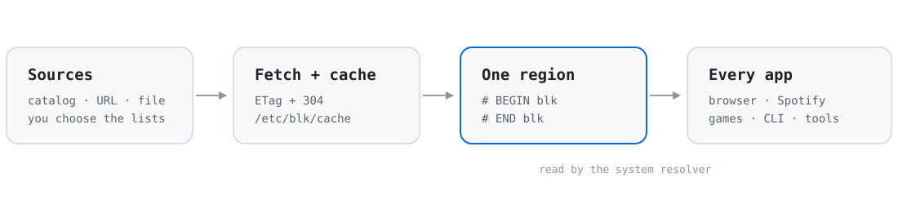
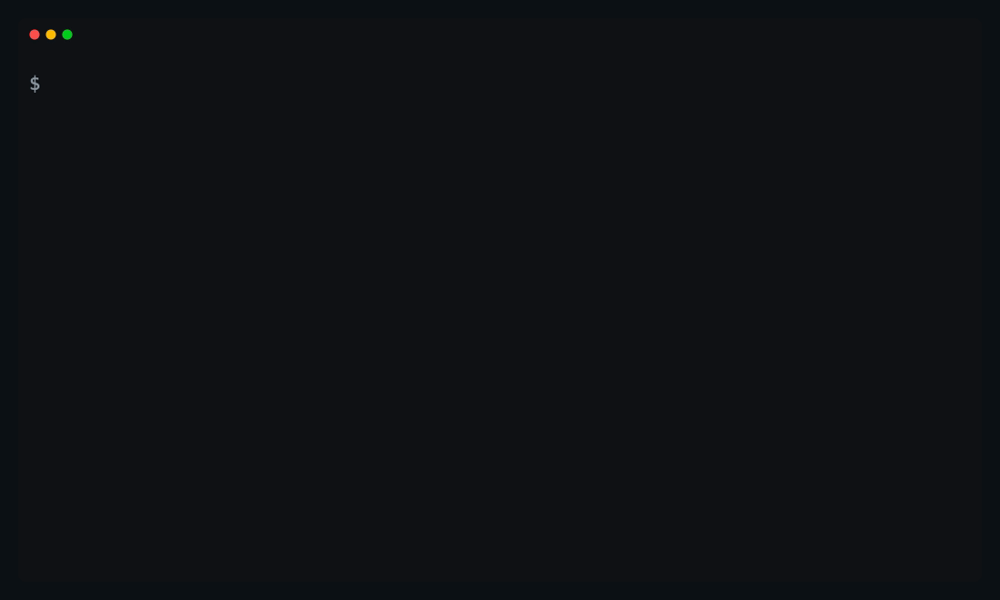

<div align="center">

<picture>
  <source media="(prefers-color-scheme: dark)" srcset="docs/assets/banner-dark.svg">
  
</picture>

<strong>Block ads, trackers, and distractions across every app on your machine.</strong>

[](LICENSE)
[](#requirements)
[](https://www.rust-lang.org)

<sub><a href="#why-blk">Why blk</a> · <a href="#install">Install</a> · <a href="#quick-start">Quick start</a> · <a href="#commands">Commands</a> · <a href="#limits">Limits</a></sub>

</div>

`blk` keeps one managed block list inside your hosts file. Choose sources from a catalog or point it at your own lists. It fetches them with conditional requests, writes one `# BEGIN blk` region, and leaves the rest of the file alone. Pause blocking from the terminal for 25 minutes and it comes back on its own.

A browser extension sees one browser. A hosts file sits under the whole operating system, so the same block applies to every browser, desktop app, game launcher, webview, and command-line tool. The request is answered locally, so nothing waits for an ad server.

> [!NOTE]
> Hosts blocking matches exact hostnames. It cannot remove ads served from the same host as the content, such as YouTube pre-rolls, and an app that uses its own DNS can bypass it. See [Limits](#limits).

## Why blk

### Ads stop before the connection opens

The system resolver returns `0.0.0.0` for a blocked host. No packet reaches the ad or tracker server, and there is no page-level filter to outrun. That covers the browser you use for work and the one you forgot was open, plus the webviews inside desktop apps.

### Free tiers get quieter

Ad-supported apps call the same ad hosts a web page does, so the block reaches them too. Free-tier Spotify is the usual example: its audio ads come from separate ad domains, and a list that covers them can quieten the ads while playback keeps working. There is no Spotify integration here. It is a side effect of blocking system-wide, and ad delivery changes, so treat it as a bonus rather than a guarantee.

### A pause button for the scroll

Purpose lists group the sources for social media, streaming, gambling, adult content, piracy, malware, and ads behind one toggle. Turn one on for a work block. `blk pause 25` gives it back for 25 minutes, then blocking returns by itself. Changing the lists needs `sudo`, which is enough friction to make the choice deliberate. It is a speed bump, not a lock.

### Nothing running in the background

No proxy, no DNS server, no daemon, no account, no telemetry. The operating system already reads the hosts file. `blk` writes one region and gets out of the way.

### Boring where it counts

Writes go through a temp file in the same directory, an fsync, and a rename, with the mode preserved. The first change saves a backup. `resume` restores the region byte for byte. `blk doctor` checks the markers, cache, backup, and drift when something looks wrong.

## Install

```shell
cargo install block-list --locked
```

The package is `block-list`; the binary is `blk`. `--locked` installs the versions pinned in `Cargo.lock`. Add `--force` to reinstall the same version.

### Requirements

- macOS or Linux.
- Rust stable to build from source.
- Root only for commands that write the hosts file or `/etc/blk`.

## Quick start

```shell
sudo blk sources      # choose providers from the catalog
sudo blk update       # fetch and write the region
blk status            # read it back without root
```

`blk sources` opens a picker on a terminal and applies the result. `sudo blk update` refreshes every configured source. `blk` on its own opens the menu.

<p align="center">
  
</p>
<p align="center"><sub>Bare <code>blk</code> on a terminal: Blocking, Sources, Lists, Tools, Quit. Every action is also a subcommand.</sub></p>

## How it works

<p align="center">
  <picture>
    <source media="(prefers-color-scheme: dark)" srcset="docs/assets/flow-dark.svg">
    
  </picture>
</p>

`blk` writes exactly one region:

```txt
# BEGIN blk
# list: stevenblack/social
0.0.0.0 ads.example
# list: hagezi/normal
0.0.0.0 tracker.example
# END blk
```

Only that region is rewritten. Anything before or after it stays as it was. A run aborts on zero, duplicate, or unbalanced markers, so a damaged file is not silently repaired. A legacy `# Block List` tail from version 1 is never read, migrated, or deleted; `doctor` warns about it.

Updates use conditional requests. Each source is cached under `/etc/blk/cache/<slug>` with `.etag` and `.src` sidecars. The next run sends `If-None-Match`; a `304` keeps the cached body and writes no hosts file. A failed download leaves `/etc/hosts` and the cache as they were. `--offline` rebuilds from the cache with no network access.

## Purpose lists

A list is a named bundle of sources. It is on when every member is configured; there is no stored enabled flag.

| list | sources |
| --- | --- |
| Ads and trackers | `stevenblack/hosts`, `1hosts/lite` |
| Social media | `blk/social` |
| Media streaming | `blk/streaming`, `blocklistproject/youtube` |
| Anime and piracy | `blocklistproject/piracy`, `blocklistproject/torrent` |
| Gambling | `stevenblack/gambling` |
| Adult content | `stevenblack/porn` |
| Malware and phishing | `malwarefilter/urlhaus`, `hagezi/pro` |

<p align="center">
  
</p>
<p align="center"><sub>Turning a list on applies the new sources. Cached sources are reused, so the toggle is fast.</sub></p>

`blk lists` and `blk lists toggle "Social media"` work without a terminal. Create, edit, and delete custom lists in the menu under Lists.

- Turning a list off keeps any member that another fully enabled list still needs.
- Editing an enabled custom list follows the same rule.
- Preset names are reserved and presets are immutable.
- Custom names are case-sensitive and unique.
- Deleting a list keeps its sources configured.

`blk/social` and `blk/streaming` ship inside the binary. They work offline, need no cache, and change only with a release. The social list contains no WhatsApp domains. Streaming lists block the service domains themselves, so choosing one blocks the service.

## Pausing

<p align="center">
  
</p>
<p align="center"><sub>A timed pause holds the terminal, shows when it ends, and restores on Ctrl-C.</sub></p>

```shell
sudo blk pause 25                      # every source, 25 minutes
sudo blk pause stevenblack/social 1h   # one source, one hour
sudo blk off                           # every source, indefinitely
sudo blk resume                        # restore now
```

A bare number means minutes, so `blk pause 30` is the same as `blk pause 30m`. Durations accept `s`, `m`, `h`, and `d`, and combine, as in `1h30m`.

The pause writes the region it replaced to `pause.region` and empties the chosen sections. The held process restores the snapshot on expiry, `SIGINT`, `SIGTERM`, or `SIGHUP`. Without a terminal it exits immediately and says nothing will restore it automatically. If the process is killed with `SIGKILL`, the record survives. The next command reports a live pause, and restores one whose deadline has passed. An explicit `update` clears the record. There is one pause at a time.

## Checking what is on

```shell
blk status
blk status --json
blk test instagram.com
sudo blk doctor
```

`status` prints the region, per-source counts, the last update, the pause, and warnings. JSON emits `hosts`, `active`, `last_update`, `sources`, `total_entries`, `pause`, and `warnings`; `until` is `null` for an indefinite pause. Warnings are `legacy-block-list`, `region-drift`, `cache-missing:<source>`, and `pause-expired`. Status exits 0 with warnings.

`test` reads the hosts file only, with no resolver and no network. It reports `blocked by blk`, `blocked by another line`, or `not blocked`.

`doctor` checks root, marker balance, cache presence, the backup, a legacy `# Block List`, drift against `state.toml`, and ABP conversion counts. It treats non-root as advisory and exits 1 when it finds a problem.

## Commands

| command | what it does |
| --- | --- |
| `blk` | open the grouped menu on a terminal; print status and usage otherwise, exit 2 |
| `blk status [--json]` | show the region, source counts, last update, pause, and warnings |
| `blk update [SOURCE...] [--from URL_OR_PATH]` | fetch the configured sources and rewrite the region |
| `blk sources` | choose sources from the catalog, interactive |
| `blk add <SOURCE>...` | add a source and apply |
| `blk rm <SOURCE>...` | remove a source and rebuild |
| `blk lists [toggle <NAME>]` | show purpose lists, or turn one on or off |
| `blk pause [SOURCE...] [DURATION]` | pause all or some sources |
| `blk off` | pause every source with no deadline |
| `blk resume` | restore a paused region |
| `blk test <DOMAIN>` | report whether a domain is blocked |
| `blk doctor` | check markers, cache, backup, and drift; exit 1 on problems |
| `blk config` | open the config file in `$EDITOR` |
| `blk catalog [SOURCE]` | list the built-in sources, or print one source's URLs |
| `blk completions <SHELL>` | print a completion script for bash, zsh, fish, elvish, or powershell |

| option | meaning |
| --- | --- |
| `--hosts <PATH>` | hosts file to edit, default `/etc/hosts` |
| `--offline` | rebuild from the cache, no network |
| `--dry-run` | print the counts, sizes, and source changes; write nothing |
| `--yes` | skip the confirmation prompt |
| `--quiet` | suppress normal output |

## Sources

`blk catalog` prints each source with its format, URL or domain count, and licence.

| source family | format | covers |
| --- | --- | --- |
| `stevenblack/hosts`, `social`, `gambling`, `porn` | hosts | ads, social, gambling, adult content |
| `oisd/small`, `oisd/big` | wildcard domains | ads and trackers |
| `hagezi/normal`, `hagezi/pro` | domains | ads, trackers, malware |
| `1hosts/lite` | hosts | ads and trackers |
| `peterlowe/hosts` | hosts | ads and trackers |
| `malwarefilter/urlhaus` | hosts | malware and phishing |
| `blocklistproject/youtube`, `piracy`, `torrent` | hosts | streaming, piracy, torrents |
| `brave/default` | ABP bundle | ads, trackers, annoyances |
| `blk/social`, `blk/streaming` | inline domains | curated social and streaming |

`brave/default` is an ABP bundle of 22 files, not a hosts file, so it is converted. The converter keeps `||domain^` rules, subtracts domains named by `@@||domain^` exceptions, and drops cosmetic, path, option, regex, and `$badfilter` rules. It prints kept and dropped counts when it parses an ABP source.

Add a URL or a local list with `blk add`, or append one with `blk update --from`. Both save the source to the config:

```shell
sudo blk add https://example.com/list.hosts
sudo blk update --from /path/to/list.hosts
```

Every source becomes its own `# list:` section, so domains are not deduped across sources. Within a source, duplicates are removed in first-seen order.

## Files

`blk` keeps its state in `/etc/blk`:

| file | contents |
| --- | --- |
| `config.toml` | the ordered source list and custom purpose lists |
| `state.toml` | last update, hosts path, region hash, per-source counts |
| `pause.toml` | the current pause record |
| `pause.region` | the region as it was when the pause started |
| `hosts.bak` | a copy of the hosts file from before the first change |
| `cache/` | downloaded lists, with `.etag` and `.src` sidecars |

Set `BLK_DIR` to use a different directory. The test suite and the demo tapes use it with a temporary hosts file.

## Removing blk

Restore a pause first if one is active, then remove the sources:

```shell
sudo blk resume
sudo blk rm <source> [<source>...]   # repeat until the region is empty
rm -rf /etc/blk
```

Removing the last source removes the region and `state.toml` and keeps the rest of the hosts file. If you want the file from before the first `blk` write instead, restore the backup manually; that also discards any hand edits made since:

```shell
sudo cp /etc/blk/hosts.bak /etc/hosts
```

## Limits

- A hosts entry blocks one exact hostname. Subdomains are blocked only when the list includes them. ABP's `||example.com^` covers subdomains, which a hosts file cannot.
- ABP conversion is lossy. Brave's bundle is mostly cosmetic and path rules, so only part of it becomes hosts entries.
- Ads served from the same host as the content remain. YouTube pre-rolls are the usual example.
- Apps that use their own DNS (DNS over HTTPS, for instance) or hardcoded IP addresses can bypass the hosts file. Some browsers have a secure DNS setting that does the same.
- Ad and tracker domains change. Lists are snapshots; schedule updates.
- Blocking can break a login, payment, or update flow that reuses a tracker host. Pause for a minute to check before blaming the site.
- A legacy `# Block List` section from version 1 is never read, migrated, or removed. Remove it by hand after upgrading.
- The curated `blk/streaming` and `blk/social` lists only change with a release. They are not refreshed by `blk update`.

## Scheduled updates

Add this to root's crontab to refresh every night at 22:00:

```txt
0 22 * * * blk update
```

Use the absolute path from `command -v blk` if cron cannot find it. Conditional requests mean the run is cheap when no list changed.

## Upgrading from 1.x

- Uninstall the old package first: `cargo uninstall block-list`, then `cargo install block-list --locked`. Cargo does not remove a binary whose name changed. If `block-list` still sits next to `blk` in `~/.cargo/bin`, delete it; `blk doctor` warns when it finds it.
- The binary is now `blk`, not `block-list`.
- The hosts path is no longer a positional argument. It defaults to `/etc/hosts`; use `--hosts` to override.
- Lists come from the catalog. Run `blk sources` or `blk add`.
- The region format changed. An old `# Block List` tail is left untouched.
- State lives in `/etc/blk`.

## Development

```shell
cargo test
cargo clippy --all-targets -- -D warnings
cargo fmt --check
```

Network tests are marked ignored:

```shell
cargo test -- --ignored
```

The demo clips are recorded with [VHS](https://github.com/charmbracelet/vhs). Each tape writes a GIF to `docs/assets/` and uses a throwaway hosts file under `/tmp/blk-demo`:

```shell
brew install vhs
cargo build --release
vhs docs/demo/menu.tape
vhs docs/demo/lists.tape
vhs docs/demo/pause.tape
```

Run the tapes from the repository root so `Output` and the release binary resolve. The tape files live in [`docs/demo`](docs/demo).

## License

GPL-3.0. See [LICENSE](LICENSE).
