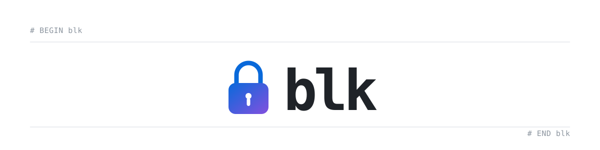

<div align="center">

<picture>
  <source media="(prefers-color-scheme: dark)" srcset="docs/assets/banner-dark.svg">
  
</picture>

<strong>A minimalist hosts-based tool for blocking websites and ads.</strong>

[](LICENSE)
[](#requirements)

</div>

## About

`blk` keeps one block list inside your hosts file. It writes a region between `# BEGIN blk` and `# END blk`, fetches lists from a catalog, and can pause blocking for a set time. It runs on macOS and Linux.

## Why use blk?

- It blocks ads and trackers for every program on the system, including apps outside the browser.
- It can reduce ads inside apps such as Spotify, because the block happens below the app.
- It helps you step away from social media and streaming. Choose a list, then pause it when you need to.
- It uses the hosts file the system already reads. No background service, account, or telemetry.
- It is easy to undo. Pause restores the previous region, and the first change keeps a backup.

## Install

### Cargo

```shell
cargo install block-list
```

The package is `block-list`; the binary is `blk`.

### Homebrew

```shell
brew tap OliverBrotchie/block-list https://github.com/OliverBrotchie/block-list
brew trust OliverBrotchie/block-list
brew install --HEAD OliverBrotchie/block-list/blk
```

Homebrew builds the main branch. Use Cargo for a tagged release.

### Requirements

- macOS or Linux.
- Rust stable to build from source.
- Root only for commands that write the hosts file or `/etc/blk`.

The menu needs root. Run `sudo blk`; without root it exits with a sudo hint. `blk status`, `blk test`, `blk lists`, and `blk catalog` run as your user. The other examples use `sudo`.

## Usage

```shell
sudo blk sources      # choose lists from the catalog
sudo blk update       # fetch and write the region
blk status            # read it without root
```

`sudo blk` opens the menu. Without root it exits with a sudo hint.

<p align="center">
  
</p>
<p align="center"><sub>Choosing lists in the menu. <code>sudo blk sources</code> opens the same picker.</sub></p>

```shell
blk status [--json]           # region, counts, pause, and warnings
blk test instagram.com        # check one hostname against the hosts file
sudo blk doctor               # markers, cache, backup, and drift
```

`blk status` exits 0 with warnings; `blk doctor` exits 1 when it finds a problem.

## Pausing

<p align="center">
  
</p>
<p align="center"><sub>Pausing a list in the menu. Ctrl-C restores the previous region.</sub></p>

```shell
sudo blk pause 25                      # every source, 25 minutes
sudo blk pause stevenblack/social 1h   # one source, one hour
sudo blk off                           # every source, indefinitely
sudo blk resume                        # restore now
```

A bare number means minutes, so `blk pause 30` is the same as `blk pause 30m`. Durations accept `s`, `m`, `h`, and `d`, and combine, as in `1h30m`.

The pause saves the region to `pause.region` and empties the chosen sections. The held process restores it on expiry, `SIGINT`, `SIGTERM`, or `SIGHUP`. Without a terminal it exits and says nothing will restore it automatically. If the process is killed with `SIGKILL`, the next command reports a live pause and restores one whose deadline has passed. There is one pause at a time.

## Purpose lists

A list is a named bundle of sources. It is on when every member is configured.

| list | sources |
| --- | --- |
| Ads and trackers | `stevenblack/hosts`, `1hosts/lite` |
| Social media | `blk/social` |
| Media streaming | `blk/streaming`, `blocklistproject/youtube` |
| Malware and phishing | `malwarefilter/urlhaus`, `hagezi/pro` |

Run `blk lists` for the full set. `sudo blk lists toggle "Social media"` works without a terminal; create and edit custom lists in the menu.

- Turning a list off keeps a member that another enabled list still needs.
- Editing an enabled custom list follows the same rule.
- Preset names are reserved and presets are immutable.
- Deleting a list keeps its sources configured.

`blk/social` and `blk/streaming` ship inside the binary. They work offline and change only with a release. The social list contains no WhatsApp domains.

## What blk writes

```txt
# BEGIN blk
# list: stevenblack/social
0.0.0.0 ads.example
# list: hagezi/normal
0.0.0.0 tracker.example
# END blk
```

Only this region is rewritten. Writes use a temp file in the same directory, an fsync, and a rename, with the mode preserved. The first change saves `/etc/blk/hosts.bak`. A file with zero, duplicate, or unbalanced markers is left untouched.

`blk update` fetches each source with a conditional request and caches it under `/etc/blk/cache/` with `.etag` and `.src` sidecars. A `304` keeps the cached body and writes no hosts file. A failed download leaves `/etc/hosts` and the cache as they were. `--offline` rebuilds from the cache.

## Commands

| command | what it does |
| --- | --- |
| `blk` | open the menu on a terminal with root; print status and usage otherwise, exit 2 |
| `blk status [--json]` | show the region, source counts, last update, pause, and warnings |
| `blk update [SOURCE...] [--from URL_OR_PATH]` | fetch the configured sources and rewrite the region |
| `blk sources` | choose sources from the catalog, interactive |
| `blk add <SOURCE>...` | add a source and apply |
| `blk rm <SOURCE>...` | remove a source and rebuild |
| `blk lists [toggle <NAME>]` | show purpose lists, or turn one on or off |
| `blk pause [SOURCE...] [DURATION]` | pause all or some sources |
| `blk off` | pause every source with no deadline |
| `blk resume` | restore a paused region |
| `blk test <DOMAIN>` | report whether a domain is blocked |
| `blk doctor` | check markers, cache, backup, and drift; exit 1 on problems |
| `blk config` | open the config file in `$EDITOR` |
| `blk catalog [SOURCE]` | list the built-in sources, or show one source's URLs |
| `blk completions <SHELL>` | print a completion script for bash, zsh, fish, elvish, or powershell |

| option | meaning |
| --- | --- |
| `--hosts <PATH>` | hosts file to edit, default `/etc/hosts` |
| `--offline` | rebuild from the cache, no network |
| `--dry-run` | print the counts, sizes, and source changes; write nothing |
| `--yes` | skip the confirmation prompt |
| `--quiet` | suppress normal output |

## Sources

`blk catalog` prints each source with its format, URL or domain count, and licence.

| source family | format | covers |
| --- | --- | --- |
| `stevenblack/*` | hosts | ads, social, and other categories |
| `oisd/*` | wildcard domains | ads and trackers |
| `hagezi/*` | domains | ads, trackers, malware |
| `1hosts/lite`, `peterlowe/hosts` | hosts | ads and trackers |
| `malwarefilter/urlhaus` | hosts | malware and phishing |
| `blocklistproject/*` | hosts | youtube and torrents |
| `brave/default` | ABP bundle | ads and trackers |
| `blk/social`, `blk/streaming` | inline domains | curated social and streaming |

`brave/default` is a bundle of 22 ABP files, so it is converted. The converter keeps `||domain^` rules, subtracts domains named by `@@||domain^` exceptions, and drops cosmetic, path, option, regex, and `$badfilter` rules.

Add a URL or a local list with `blk add`, or append one with `blk update --from`:

```shell
sudo blk add https://example.com/list.hosts
sudo blk update --from /path/to/list.hosts
```

## Files

`blk` keeps its state in `/etc/blk`:

| file | contents |
| --- | --- |
| `config.toml` | the ordered source list and custom purpose lists |
| `state.toml` | last update, hosts path, region hash, per-source counts |
| `pause.toml` | the current pause record |
| `pause.region` | the region as it was when the pause started |
| `hosts.bak` | a copy of the hosts file from before the first change |
| `cache/` | downloaded lists, with `.etag` and `.src` sidecars |

Set `BLK_DIR` to use a different directory. The tests use it.

## Limits

- A hosts entry blocks one exact hostname. Subdomains are blocked only when the list includes them.
- ABP conversion is lossy. Cosmetic, path, and option rules cannot be expressed in a hosts file.
- Ads served from the same host as the content remain, such as YouTube pre-rolls.
- Apps that use their own DNS, or hardcoded IP addresses, can bypass the hosts file.
- Ad and tracker domains change. Schedule updates.
- Blocking can break a login, payment, or update flow that reuses a tracker host. Pause for a minute to check.

## Scheduled updates

Add this to root's crontab to refresh every night at 22:00:

```txt
0 22 * * * blk update
```

Use the absolute path from `command -v blk` if cron cannot find it.

## License

GPL-3.0. See [LICENSE](LICENSE).
